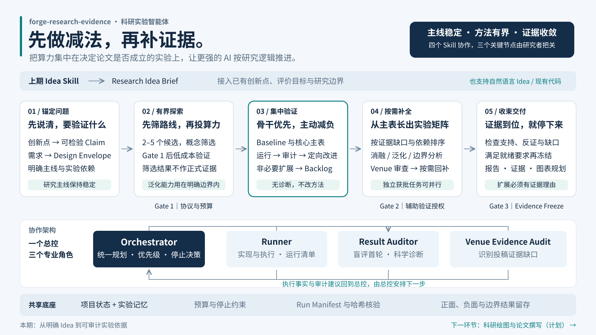

# Forge Research Evidence

> **把 Idea 锻造成 Evidence：让强大的 AI 学会取舍，先完成决定论文成败的骨干实验，再让证据矩阵有章法地生长。**

面向计算机科学、人工智能与数据驱动工科论文的**长线科研实验智能体**。它承接已经明确的 Research Idea，把方法设计、代码实现、实验执行、结果审计和投稿证据补全连接成一条可恢复、可约束、可停止的工作流。

`Forge` 取“锻造、打磨”之意：科研证据必须经过预先定义、真实运行与独立审计形成，而不是由模型凭空生成。项目展示名统一为 **Forge Research Evidence**，仓库、目录和状态标识统一使用 `forge-research-evidence`。


[完整使用说明](docs/USAGE.md) · [下载宣传海报](docs/assets/research-agent-poster.png) · [查看高清架构图](docs/assets/research-agent-overview.png) · [Apache-2.0 许可证](LICENSE)

## 30 秒了解它为什么值得使用

现在的大模型不缺方案，真正稀缺的是**科研判断**：什么必须先做，哪条路线值得算力，失败后该修执行、改方法还是重审假设，以及什么时候应该停止。

普通 AI 很容易把“能力强”变成“实验多”：不断加模块、换数据集、补测试、追分数，最后成本越来越高，论文主题反而越来越模糊。本项目把这种发散能力装进一套科研秩序中：

- **承接 Idea，不重新发明问题。** 把上一阶段形成的 Research Idea Brief 转成可检验的 Claim、Evidence Question 和实验依赖。
- **关键阶段主动做减法。** 先把预算集中到决定核心 Claim 能否成立的 P0 骨干实验；无关扩展进入 Backlog。
- **该发散时发散，该收敛时收敛。** 方法设计在 Design Envelope 内并行比较候选；主路线确定后，只允许由观察和诊断驱动的定向迭代。
- **让实验形成证据，而不只是形成分数。** 每轮结果由独立角色检查公平性、有效性、混杂因素及其对 Claim 的真实影响。
- **先有主表，再补矩阵。** 核心结果完成后，才按证据缺口补充消融、稳健性、泛化和边界分析。
- **让证据决定停止。** 每张实验卡预先声明完成条件、拒绝条件和停止条件；证据充分后冻结项目，避免无限优化。

它解决的不是“AI 能不能跑实验”，而是更难的问题：**如何让 AI 在数天或数周的实验任务里始终围绕同一篇论文，自主推进，又不越过科研边界。**

## 它不是一段提示词，而是一套协作智能体

项目由四个职责分离的 Skill、统一项目状态和实验记忆共同组成。总控掌握科研决策，专业 Skill 分别负责执行、审计与投稿证据检查，彼此交接、互相约束。

| Skill | 核心职责 | 它防住了什么 |
|---|---|---|
| `experiment-orchestrator` | 维护研究主线，规划方法，批准实验，安排预算、优先级与停止 | 多模块各说各话、任务失序、研究跑题 |
| `experiment-runner` | 按已批准的实验卡实现与运行，保存日志、指标和 Run Manifest | 临时改目标、结果无法追溯、实验不可复核 |
| `result-auditor` | 先看原始证据，再判断有效性、公平性、结论强度与失败类型 | 只挑好结果、把工程故障误判为方法失败 |
| `venue-evidence-audit` | 主结果形成后，识别目标期刊或会议真正相关的证据缺口 | 为了“看起来完整”盲目堆实验 |

Orchestrator 是唯一科研决策入口。Runner 只执行批准范围，Auditor 只审计不改方法，Venue Audit 只提出缺口不直接排队。共享状态让项目跨会话继续，也让每一次方法变化都有来由。

## 从 Idea 到可写作证据



1. **锚定论文主线**：把 Idea 转成可检验 Claim、研究边界和实验依赖。
2. **有界设计方法**：在明确的 Design Envelope 内并行生成候选，先用统一的低成本协议筛选，再决定重投入路线。
3. **集中完成骨干**：优先做数据检查、Baseline、公平比较和核心主表；每轮结果经审计后才允许定向修改。
4. **按缺口丰富矩阵**：Gate 2 之后，依据 Claim–Evidence Matrix 补充必要的消融、泛化、稳健性与边界证据。
5. **审稿式检查并冻结**：确认核心结论、复现信息和必要证据已经到位，通过 Gate 3 后停止常规扩展并交付。

三个 Human Gate 保留研究者对主线、预算与最终证据的控制。可信反证会触发假设复审，不会被系统自动包装成另一个故事。

## 你最终得到的不是聊天记录

- 可运行的共享研究代码与独立实验配置；
- Experiment Card、原始指标、日志、Artifact 与可校验 Run Manifest；
- 正面、负面、无效、边界、混杂和失败结果构成的实验记忆；
- Claim–Evidence Matrix、投稿证据缺口与就绪评估；
- 实验报告、方法演化记录和 Figure/Table Plan，可直接交给后续科研绘图与论文写作环节。

## 谁最适合使用

- 已经有论文 Idea，却不知道如何把它拆成有先后关系的实验；
- 有代码和算力，但实验越做越散、调参迟迟不能收尾；
- 希望让 Codex 长线推进科研任务，同时保留关键人工决策；
- 需要复盘“为什么改方法、失败说明什么、论文结论凭什么成立”；
- 想把 Idea、实验、绘图和写作连接成连续科研流程。

如果你只想让 AI 临时跑一条命令，这套框架会显得偏重；如果你要完成一组真正能支撑论文的实验，它提供的正是普通对话最容易缺失的科研秩序。

## 5 分钟开始

> 请下载**完整仓库**，不要只复制某一个 Skill。一项独立研究建议使用一份单独的项目副本，避免共享状态相互污染。

```bash
git clone https://github.com/cpt13-g/forge-research-evidence.git
cd forge-research-evidence
python -m pip install -r requirements.txt
python tools/validate_project.py
python tools/state_manager.py show
```

在 Codex 中打开仓库根目录。项目级 `AGENTS.md` 与 `.agents/skills/` 会随仓库加载；可以先用 `/skills` 确认四个 Skill 已出现，然后发送：

```text
使用 $experiment-orchestrator 接续我的 Research Idea Brief。
先读取 research/research_state.yaml，梳理输入缺口、核心 Claim、
Design Envelope 与骨干实验依赖，并准备 Gate 1。
Gate 1 通过前不要运行实验。

Research Idea Brief：<粘贴内容或文件路径>
已有代码与数据：<路径、可用状态、数据划分>
目标期刊/会议：<名称或待选择>
资源预算：<硬件、时间、完整实验次数>
```

仓库初始显示 `BLOCKED_INPUT / S0_INTAKE_RECOVERY` 是正常状态，表示系统正在等待你的真实研究输入。没有完整 Idea Brief 也可以开始，Orchestrator 会先补齐真正影响实验决策的信息。

详细的 ZIP 下载、环境准备、完整示例、Gate 回复方式、中断恢复和故障排查见[中文使用说明](docs/USAGE.md)。

## 科研完整性不是口号

科学实验使用 `E####`，工程调优使用 `T####`；Cheap Evaluation 和 Tuning 不能冒充正式 Claim Evidence。正式运行会记录实验卡哈希、代码与配置身份、环境、Seed、指标和产物，并在证据聚合时核验。

`COMPLETE` 表示协议要求的材料齐备，不等同于外部独立复现；数据版本、科学公平性和结论强度仍需研究者与 Auditor 判断。框架不会自动增加预算、改写 Research Spine、替用户通过 Human Gate 或解冻证据。

自动化测试用于验证流程与门禁，不等同于跨任务性能基准。实际节省的算力和成功率提升取决于研究任务、代码质量、预算设置与执行环境。

## 项目结构

```text
.agents/skills/    四个协作 Skill
schemas/          机器校验协议
templates/        初始化模板
tools/            状态、预算、实验、审计与报告工具
research/         研究状态、实验合同与方法工件
src/              共享研究实现
configs/          实验差异配置
experiments/      实验卡、运行清单、日志与结果
evidence/         实验记忆、证据矩阵与就绪状态
reports/          实验报告和图表规划
docs/assets/      中文宣传图与架构图
tests/            流程和门禁回归测试
```

- [完整使用说明](docs/USAGE.md)
- [Research Spine：设计规范](Research%20Spine.md)
- [共享协议](docs/PROTOCOLS.md) / [状态机](docs/STATE_MACHINE.md)
- [Skill 交接与权限](docs/ROLE_HANDOFFS.md)
- [方法设计与收敛](docs/METHOD_REALIZATION_PROTOCOL.md)
- [证据补全与冻结](docs/EVIDENCE_COMPLETION_PROTOCOL.md)

## 开源许可

本项目采用 [Apache License 2.0](LICENSE) 发布。欢迎在保留许可证与必要归属说明的前提下使用、修改和分发。
